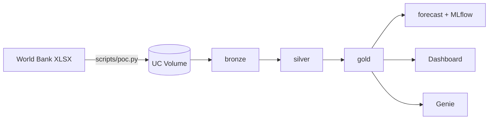

# Commodity Prices Lakehouse

Monthly commodity prices since 1960 (World Bank "Pink Sheet"), turned into bronze/silver/gold tables in
Unity Catalog, a dashboard, a Genie Q&A space and a 12-month baseline forecast tracked in MLflow.
Everything is deployed as a Databricks bundle and runs as one scheduled serverless job.

<!--  -->



## Tables (`workspace.commodities`)

| Table | Grain | Contents |
|---|---|---|
| `bronze_pinksheet_monthly` | batch × commodity × month | raw strings, append-only (`ingested_at`, `source_file`) |
| `silver_prices` | commodity × month | typed prices, commodity group; job fails on duplicates or bad rows |
| `gold_monthly_metrics` | commodity × month | MoM %, YoY %, 12-month moving average, 12-month volatility |
| `gold_latest_snapshot` | commodity | latest price, YoY, 5-year change, all-time high, `is_active` |
| `gold_forecast` | commodity × future month | 12-month Theta baseline, rolling-origin backtest MAPE vs naive, MLflow run id |

## Forecast

**Model.** For each of four commodities (Brent crude, gold, copper, Arabica coffee), a 12-month forecast with the
[Theta method](https://www.statsmodels.org/stable/examples/notebooks/generated/theta-model.html) on log prices,
using monthly data since 2000. Theta blends a long-run linear trend with exponential smoothing of the recent level.
It is simple, fast and a strong benchmark in forecasting competitions. Working on log prices keeps forecasts
positive and treats moves as percentages. Code: [`src/forecasting.py`](src/forecasting.py).

**Validation: rolling-origin backtest.** One train/test split on the last 12 months is too noisy to compare models:
a single shock (a war, a frost, a rate decision) decides the winner. Instead, the model is refit at 21 points in
time, every 3 months over the last 5 years. Each fit only sees data up to that point and forecasts the next
12 months, which are then compared with what actually happened. The score is the mean absolute percentage error
(MAPE) over all 21 windows.

**Baseline.** Every score is compared with a naive forecast, "next 12 months = last known price". Monthly
commodity prices behave much like a random walk, so this baseline is hard to beat and keeps the results honest.

**Results** (21 windows, 12-month horizon, data to 2026-10):

| Commodity | Theta MAPE % | Naive MAPE % |
|---|---|---|
| Coffee, Arabica | 16.19 | 16.26 |
| Copper | 10.65 | 10.96 |
| Crude oil, Brent | 16.22 | 15.99 |
| Gold | 9.47 | 10.15 |
| **Average** | **13.13** | **13.34** |

Theta beats the naive forecast on three of four commodities, but only by a fraction of a point. With the same
backtest, damped-trend exponential smoothing, ARIMA(1,1,0), a drift model and simple averages of these all
scored between 13.1 and 13.7. Theta was the best of these, and the simplest. Year-ahead commodity prices are
mostly unpredictable from their own history, so treat this forecast as a baseline. Each run's parameters, scores
and forecast are logged to MLflow.

## Results

_Data as of 2026-10 (71 series since 1960, 68 still reported):_
- **Energy led the year:** the energy group is up 62.8% year on year on average. European natural gas rose 161.7%
  to $28.50/mmbtu, and Brent rose 93.2% to $125.00/bbl.
- **Biggest fallers:** orange (−28.6%), Robusta coffee (−23.4%) and coconut oil (−20.3%). Beverages are the only
  group down on average (−8.4%).
- **Gold** is flat on the year (+1.2%, $4,105/toz) and 18.2% below its all-time monthly high.
- **Forecast:** Theta beats the naive forecast on 3 of 4 commodities, by less than a point (see [Forecast](#forecast)).

## Run it

Requires Python 3.10+, the [Databricks CLI](https://docs.databricks.com/dev-tools/cli/install.html) and a workspace.

```bash
databricks auth login --host https://<your-workspace>.cloud.databricks.com
python scripts/poc.py download     # fetch the Pink Sheet into data/
python scripts/poc.py upload       # create schema + volume, upload the file
databricks bundle deploy
databricks bundle run commodities_pipeline
```

Dashboard datasets are in [`dashboards/queries.sql`](dashboards/queries.sql); Genie setup is in
[`dashboards/genie_space.md`](dashboards/genie_space.md).

## Tests

```bash
pip install -r requirements-dev.txt   # needs Java 17 for PySpark
python -m pytest -q
```
The tests build a synthetic Pink Sheet workbook and run the same SQL as production on local Spark (ANSI mode).

## Layout

```
databricks.yml, resources/   bundle + job (bronze → silver → gold → forecast, monthly)
src/                         notebooks (01–04) and the logic they import (parser, transforms, forecasting)
scripts/poc.py               download, upload, run SQL
dashboards/                  dashboard SQL, Genie instructions
tests/                       pytest + synthetic fixture
```

## Notes

Prices are monthly averages in nominal USD. The forecast is a statistical baseline, not investment advice.
Data: [World Bank Commodity Price Data](https://www.worldbank.org/commodities) (not stored in this repo).
Code: MIT licence.
